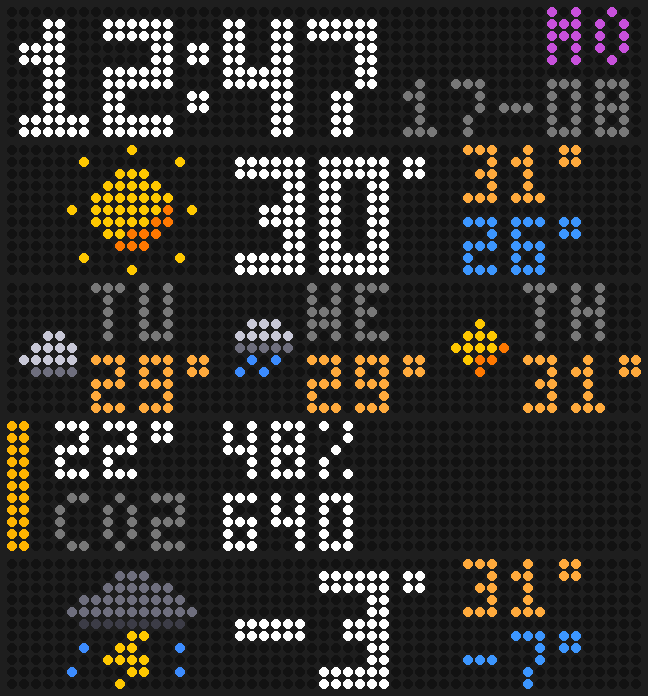

# pico-unicorn

MicroPython for the Pimoroni Galactic Unicorn (53×11 LEDs).

## Weather clock (`main.py`)

The normal screen rotates through a few pages (every 6 seconds by default):

| Page | Shows |
| --- | --- |
| Clock | `12:47` with day (`FR`) and date (`13-08`) |
| Weather | Current conditions icon, temperature, today's high / low |
| Forecast | Next 3 days: icon, day and high |
| Office | MQTT temperature, humidity and CO₂ with a comfort-colour bar (once data arrives) |



Time comes from NTP and weather from [Open-Meteo](https://open-meteo.com) (free, no API key). The time zone and daylight saving come from your weather location automatically.

Add to `config.py`:

```python
WEATHER_LAT = 51.50              # your location
WEATHER_LON = -0.12
WEATHER_UNITS = "celsius"        # optional, or "fahrenheit"
WEATHER_POLL_MINUTES = 15        # optional
CLOCK_24H = True                 # optional
PAGE_SECONDS = 6                 # optional
UTC_OFFSET_HOURS = 0             # optional, only used if weather isn't set up
NIGHT_START_HOUR = 22            # optional, dim the display from 22:00...
NIGHT_END_HOUR = 7               # ...until 07:00 (same value = never dim)
NIGHT_BRIGHTNESS = 0.05          # optional
```

At night the whole display (including any Uptime Kuma alert) drops to `NIGHT_BRIGHTNESS`. The brightness buttons adjust the night level while it's night and the day level during the day.

Buttons: **A** walks a cat across, **B** shows a little person, **C** scrolls the office temperature, and the brightness buttons work as usual.
## Uptime Kuma alerts

Built into `main.py`: when a monitor goes down or recovers, the alert takes over the whole display, and the normal office display comes back once it's done. If `KUMA_URL` isn't set in `config.py`, the alerts are switched off. `uptime_kuma.py` is a standalone version that shows only the alerts.

Shows your [Uptime Kuma](https://github.com/louislam/uptime-kuma) monitors on the Galactic Unicorn:

- **Monitor goes down** → red background, scrolls `example.com DOWN` on repeat while it stays down (cycles through every monitor that's down).
- **Monitor comes back up** → green background, scrolls `example.com UP` a couple of times, then returns to idle.
- **All good** → the weather clock in `main.py` (a blank screen with a faint heartbeat pixel in `uptime_kuma.py`).

The domain is taken from the monitor's URL (or hostname for ping/port monitors), falling back to the monitor's name.

### Setup

1. In Uptime Kuma go to **Settings → API Keys** and create a key.
2. Add these to `config.py` on the Pico:

```python
KUMA_URL = "http://192.168.1.10:3001"   # your Uptime Kuma address
KUMA_API_KEY = "uk1_xxxxxxxxxxxx"
KUMA_POLL_SECONDS = 30                  # optional, default 30
KUMA_UP_REPEATS = 2                     # optional, times to scroll "UP"
```

3. Run `main.py` as usual (or run `uptime_kuma.py` for the alerts on their own).

It reads Uptime Kuma's `/metrics` endpoint one line at a time, so it stays light on RAM even with lots of monitors. The scrolling pauses briefly (about a second) each time it polls.
